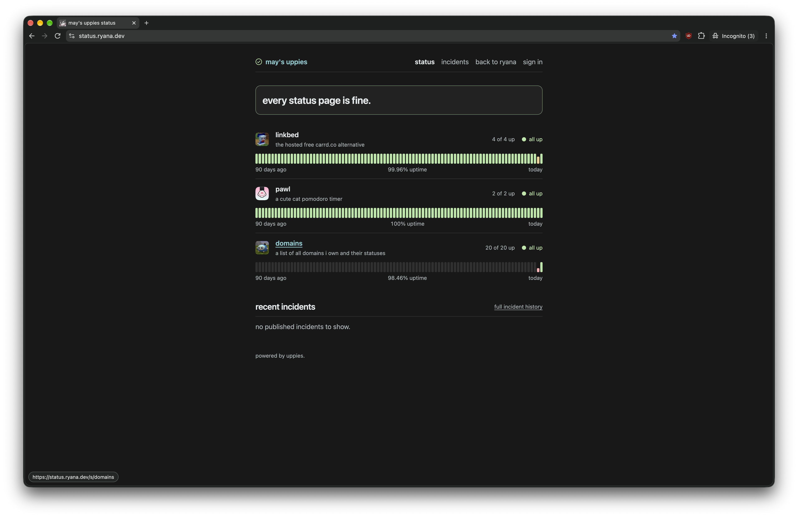

# uppies

Uppies is a self-hosted uptime monitor with **a public status page for each project**. The same monitor can appear on several pages, and the homepage shows uptime and recent incidents across them.

[See it live](https://status.ryana.dev/)



## Run it

From a checkout, start Uppies with Docker Compose. It keeps the SQLite database in a Docker volume.

```sh
docker compose -f compose.sqlite.yaml up -d
```

To build from source, use Go 1.27.4 or newer.

```sh
go build -o uppies ./cmd/uppies
./uppies -addr 127.0.0.1:8080 -db uppies.db
```

Open [localhost:8080](http://localhost:8080) to create your admin account, then add a monitor and put it on a status page.

For a public install, use an HTTPS reverse proxy that forwards `Host` and `X-Forwarded-Proto`.

If you forget a password, `reset-password` prints a new one and signs the account out everywhere. Point it at the server's database, and add `-db-backend` if the server uses one.

```sh
docker compose -f compose.sqlite.yaml exec uppies /uppies reset-password -db /data/uppies.db <username>
./uppies reset-password -db uppies.db <username>
```

[API reference](API.md) · [Roadmap](ROADMAP.md)

## License

Uppies is licensed under the [MIT License](LICENSE).
